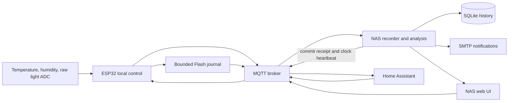

# ESP32-C3 Incubator Light Controller & Data Logger

[简体中文](README.zh-CN.md) · [Bilingual wiki](wiki/Home.md) · [Wiring](wiki/Hardware.md) · [Customization](wiki/Customization.md)

Two independently controlled light channels, sensor acquisition, Home Assistant integration and a NAS recorder for an experimental light incubator. The ESP32 runs the local schedule; the NAS stores history, evaluates optical feedback, fits PWM calibration data and sends notifications.

**Current source: Connected-2.2.3 + NAS-Recorder-2.2.3, a candidate awaiting hardware acceptance.** It adds Flash-backed sensor history to the user-accepted Connected-2.2.2 / NAS-Recorder-2.2.2c baseline. See [validation and limitations](wiki/Validation.md) before calling this iteration stable. A project license has not yet been chosen; see [license status](LICENSE-STATUS.md).

## What is included

- Manual, daily and multi-step cyclic operation per channel; concurrent outputs; runtime LEDC PWM at 40–20,000 Hz.
- DHT11 temperature/humidity, two raw ADC light detectors, optional OLED and BLE.
- Per-channel restart policies and NAS-assisted cycle progress recovery.
- Wi-Fi provisioning, a small device entry page, full local fallback and a NAS-hosted main UI.
- MQTT discovery for Home Assistant, raw optical history, SQLite/CSV, NAS optical models and optional SMTP notifications.
- New bounded Flash journal: adaptive offline snapshots at 1s, then 3s after 3min, then 10s after 15min, per-boot ordering, replay after a NAS commit receipt, and same-boot time reconstruction after NAS/NTP sync.

This is a prototype light controller, not a temperature regulator or a hardware overcurrent protector. INA226 current sensing is a documented future extension, not implemented protection.

## Start here

1. Read the [hardware and power wiring](wiki/Hardware.md). First tests use USB only, with the 24 V load disconnected.
2. [Build and flash](wiki/Firmware.md); review [pin/module customization](wiki/Customization.md).
3. [Deploy the NAS stack](wiki/Deployment.md), then configure Wi-Fi and MQTT using your own device ID and secrets.
4. Connect [Home Assistant](wiki/Home-Assistant.md), test each channel, and calibrate [optical feedback](wiki/Calibration.md).
5. Verify [recovery and offline history](wiki/Recovery-and-History.md) before an unattended experiment.

## Repository map

| Directory | Contents |
|---|---|
| firmware/IncubatorController | Arduino sketch, local control, acquisition and Flash journal |
| services/recorder | Cumulative NAS source, dashboard, analysis, notifier, vendor dependencies and tests |
| third_party/IncubatorNimBLE | Modified, licensed NimBLE-Arduino 2.5.1 peripheral profile |
| tools | Deployment preparation, build helpers, tests, deterministic web-asset generation |
| tests | Host-side storage and protocol checks |
| assets | Editable signal and DC power wiring diagrams |
| wiki | English and Chinese GitHub Wiki source pages |

Run the backend checks with Python 3.12+:

~~~sh
python tools/test_backend.py
~~~

The wiki is readable inside this repository. Publishing it to GitHub's Wiki requires a separate wiki repository; [first upload instructions](wiki/Publishing.md) explain this. Historical experiments are summarized in [version history](CHANGELOG.md); raw logs, credentials, flash dumps and unreviewed old archives are excluded.

## Architecture

