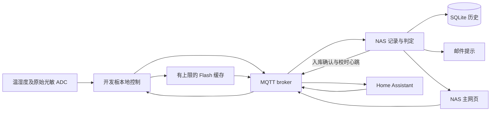

# ESP32-C3 培养箱光照控制与数据记录系统

[English](README.md) · [中英文 Wiki](wiki/Home.md) · [接线与器件清单](wiki/Hardware-zh-CN.md) · [针脚和模块定制](wiki/Customization-zh-CN.md)

用于实验培养箱的双路独立光照控制、传感器采集、Home Assistant 接入及 NAS 长期记录。开发板执行本地定时和采集；NAS 负责历史存储、光反馈判定、PWM 标定模型及邮件通知。

**当前源码为 Connected-2.2.4 + NAS-Recorder-2.2.3a，属于待实机验收的候选版。** 包含传感器 Flash 历史缓存、记录器限量时间回填，以及本机网页和 MQTT 恢复流程修复。详见[固件改动](docs/firmware-2.2.4-zh-CN.md)、[记录器改动](docs/nas-2.2.3a-zh-CN.md)及[验证清单](wiki/Validation-zh-CN.md)。项目许可证暂未选择，见[许可证状态](LICENSE-STATUS.md)。

## 已实现功能

- 两路分别设置手动、每日定时、多步骤循环；允许同时开启；运行中调整 40–20,000 Hz LEDC PWM。
- DHT11 温湿度、两路光敏 ADC；可在编译时关闭 OLED、蓝牙或传感器模块。
- 每路分别设置手动、每日、循环恢复，以及 NAS 辅助循环进度恢复。
- Wi-Fi 配网、开发板简易入口、本地完整备用页和 NAS 主网页。
- Home Assistant MQTT 自动发现、原始光照记录、SQLite/CSV、NAS 光照标定模型、独立 SMTP 发件服务。
- 本次新增：1秒→3秒→10秒分阶段降采样的 Flash 原始传感器记录、跨开机分段排序、收到 NAS 入库回执后释放，以及同次开机校时后的时间回填。

本项目控制光源，尚未实现温控或 INA226 电流采集，也不提供硬件短路保护。

## 从零复现

1. 先读[器件和电源接线](wiki/Hardware-zh-CN.md)。首次测试仅用 USB，断开 24 V 负载。
2. 按[固件编译刷写](wiki/Firmware-zh-CN.md)操作；改针脚或禁用模块请读[定制说明](wiki/Customization-zh-CN.md)。
3. [部署 NAS 容器](wiki/Deployment-zh-CN.md)，使用自己的设备编号、Wi-Fi 和 MQTT 密码。
4. [接入 HA](wiki/Home-Assistant-zh-CN.md)，逐路测试后设置[光反馈校准与通知](wiki/Calibration-zh-CN.md)。
5. 完成[重启恢复与断联补传测试](wiki/Recovery-and-History-zh-CN.md)，再投入实际实验。

| 路径 | 内容 |
|---|---|
| firmware/IncubatorController | Arduino 固件、灯控、采集、Flash 缓存 |
| services/recorder | 已合并历史修复的 NAS 程序、网页、分析、发件服务和测试 |
| third_party/IncubatorNimBLE | 保留第三方许可证的 BLE 库及修改说明 |
| tools、tests | 部署准备、构建、隐私检查和测试工具 |
| assets | 可编辑的信号、电源接线图 |
| wiki | 内容对应的中英文 Wiki 源文件 |

使用 Python 3.12 或更新版本检查 NAS 程序：

~~~sh
python tools/test_backend.py
~~~

历史版本可从[版本下载目录](archive/README.zh-CN.md)独立获取，每包包含该版本的安装、依赖、接线及已知问题说明。参见[版本记录](CHANGELOG.md)和[备份与版本选择](wiki/Publishing-zh-CN.md)。

## 系统结构

