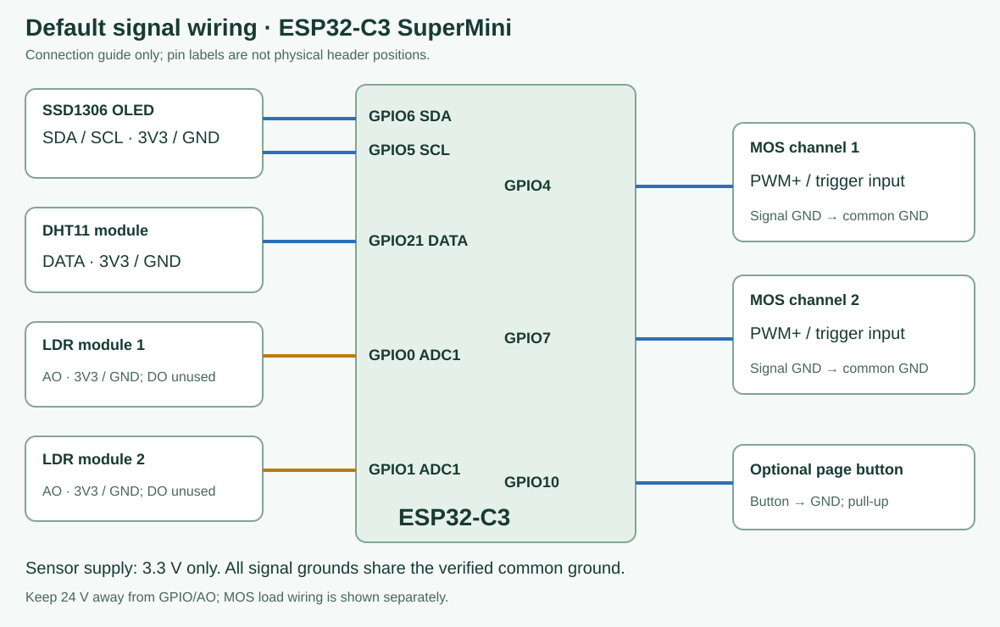
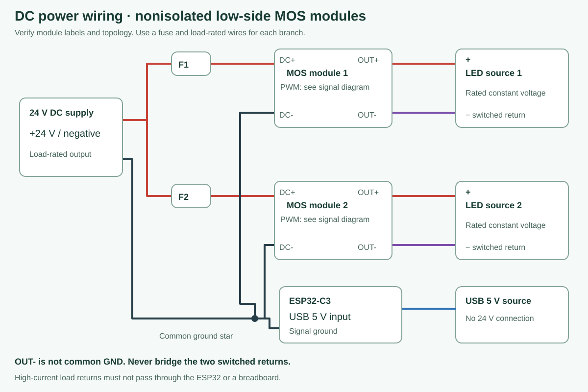

# 器件清单与接线

图中为连接关系，不代表实际排针位置。不同 SuperMini 和 MOS 模块必须核对丝印、输入电平及电路类型。

| 器件 | 数量 | 要求 |
|---|---:|---|
| ESP32-C3 SuperMini | 1 | 4 MB Flash、可传数据的 USB；核对实际板型 |
| MOS 触发开关模块 | 2 | 非隔离低侧直流开关、3.3 V 输入可触发，满足实际负载及 PWM 要求 |
| LED 光源 | 2 路 | 与电源匹配的恒压灯带/灯板，自带合适限流电阻或驱动 |
| 直流电源 | 1 | 示例为 24 V，按总负载和温升留余量 |
| DHT11 模块 | 可选 1 | 电源和 DATA 适配 3.3 V；固件为 RMT 有界 DHT11 解码 |
| SSD1306 OLED | 可选 1 | I2C、128×64、0x3c 或 0x3d、适配 3.3 V |
| 四线光敏模块 | 可选 2 | VCC/GND/AO/DO 型，3.3 V 供电，AO 不得超过 3.3 V |
| 翻页按键 | 可选 1 | 按键接地，启用内部上拉 |
| 保险、端子、线材、外壳 | 按需 | 按实测电流选型，负载回路独立布线并绝缘 |
| MOS 输入下拉 | 按需 2 | 若模块未提供合适下拉，可在控制输入加约 10 kΩ 下拉 |

| 信号 | 默认接法 |
|---|---|
| MOS 控制 1 / 2 | GPIO4 / GPIO7 |
| OLED SDA / SCL | GPIO6 / GPIO5 |
| DHT11 DATA | GPIO21，需开启 USB CDC |
| 光敏 AO 1 / 2 | GPIO0 / GPIO1，ADC1；DO 不接 |
| 翻页按键 | GPIO10 → 按键 → GND |
| 额外两路按键 | 仅关闭光敏编译选项后，可用 GPIO0 / GPIO1 |

ESP32 由 USB 5 V 供电，灯源由独立 24 V 电源供电。确认是非隔离 MOS 拓扑后，在合适的星形接地点连接信号 GND 与电源负极。大电流回路不能通过面包板、开发板地线。OUT- 是受开关控制的负载回路，不能直接接公共 GND，也不能把两路 OUT- 互接。分路加保险，并核对模块 DC+/DC-/OUT+/OUT- 标记。

功率示例：两路各 4.9 m、20 W/m 的 24 V 灯带，每路约 98 W / 4.08 A，总计 196 W / 8.17 A。200 W 电源几乎没有余量，两组输出接线不会使额定功率翻倍。必须实测电流、导线和模块温升；商家标称电流和 PWM 上限不等于已完成负载验收。

不要短接灯带限流电阻来试漏电。关灯微亮可能来自漏电或意外回流；软件关闭不等于电气隔离。24 V、5 V 传感器输出均不得进入 ESP32 GPIO。

INA226 尚未接入固件。R100 表示 0.1 Ω，按 INA226 的 ±81.92 mV 分流输入量程，仅约 0.819 A；不能原样用于约 4 A 的每路负载。参见[TI 数据手册](https://www.ti.com/lit/ds/symlink/ina226.pdf)。保险不能用软件电流判断替代。

